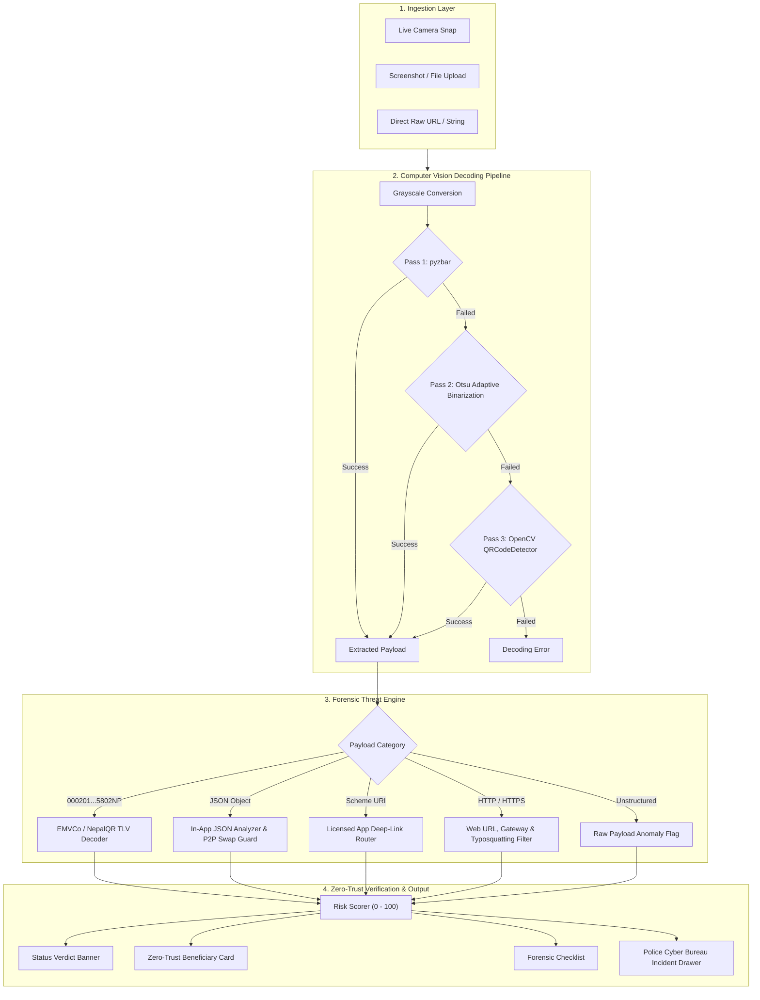

# SajagQR Shield — System Architecture & Forensic Specification

## Overview

**SajagQR Shield** is a cybersecurity tool and payment telemetry engine designed to protect retail users, merchants, and financial institutions in Nepal from **quishing** (QR code phishing), brand impersonation, fraudulent link routing, and physical standee overlay sticker attacks.

---

## 1. Ingestion Layer

The application provides three input channels tailored for different incident response scenarios:

| Ingestion Mode | Input Source | Primary Use Case |
| :--- | :--- | :--- |
| **📸 Camera Snap** | WebRTC camera stream via `st.camera_input` | On-site retail verification at grocery stands, petrol pumps, and merchant checkout counters. |
| **📁 File Upload** | File stream via `st.file_uploader` (PNG, JPG, JPEG) | Forensic auditing of screenshots received via social media, chat apps (WhatsApp, Viber), or suspicious invoices. |
| **🔗 Raw Link / URL** | String input via `st.text_input` | Direct auditing of payment gateway URLs, mobile deep links, or copied payload strings without an image. |

---

## 2. Multi-Stage Computer Vision Decoding Pipeline

QR codes captured at point-of-sale standees frequently suffer from glare, smudges, poor ambient lighting, and camera angle distortion. SajagQR deploys a progressive 3-stage decoding fallback pipeline in [`safe_decode_qr`](file:///c:/projects/sajag-qr/QR-shield/app.py#L207):

1. **Pass 1 — High-Speed Native `pyzbar`**:
   The input byte stream is converted to a NumPy array, decoded with OpenCV into BGR format, converted to grayscale, and passed to the C-based `zbar` engine.
2. **Pass 2 — Adaptive Otsu Thresholding (`cv2.THRESH_OTSU`)**:
   If Pass 1 fails due to low contrast, reflections on laminated acrylic standees, or uneven illumination, Otsu's optimal binarization algorithm calculates the bimodal histogram threshold and repeats the `pyzbar` scan.
3. **Pass 3 — OpenCV `QRCodeDetector` Fallback**:
   If `pyzbar` fails both passes, the native OpenCV QR detector (`detectAndDecode`) is executed to resolve damaged alignment patterns or non-standard finder marks.

---

## 3. Threat Heuristics Engine

Once the payload string is recovered, [`evaluate_threat`](file:///c:/projects/sajag-qr/QR-shield/app.py#L260) analyzes the payload structure against institutional registries and security directives:

### 3.1 EMVCo (NepalQR) TLV Decoder
When a payload begins with `000201` and contains `5802NP`, it represents the interoperable NepalQR standard approved by Nepal Rastra Bank (NRB). The parser traverses the Tag-Length-Value (TLV) byte structures:
- **Tag 59**: Merchant Name
- **Tag 60**: Merchant City
- **Tag 58**: Country Code (`NP`)
- **Verdict**: `SAFE` (Threat Score: `0/100`)

### 3.2 In-App JSON Analyzer & Physical Standee Swap Detection
Mobile wallet apps (eSewa, Khalti, PrabhuPAY) often generate JSON payloads for direct transfers. The engine:
1. Validates the JSON schema and scans for official identity keys (`eSewa_id`, `khalti_id`, `prabhu_id`, `hamropay_id`, `accountNumber`).
2. Checks beneficiary account numbers:
   - **Bank Accounts (`accountNumber` / `bankCodeCIPS`)**: Validated as institutional settlement transfers without mobile number format penalties.
   - **Telecom Mobile Identifiers**: Validated against Nepal's 10-digit mobile numbering plan (`^(98|97)\d{8}$`).
3. **Physical Standee Swap Advisory**: When an individual P2P wallet is identified (`is_personal_p2p = True`), a warning is surfaced:
   > *Advisory: This payload points to an individual personal wallet, NOT an institutional merchant stand. If scanning at a counter, verify that no overlay sticker has been pasted over the merchant's real standee.*

### 3.3 Licensed Mobile Deep-Link Router
Verifies native application invocation schemes against registered fintech applications (`esewa://`, `khalti://`, `fonepay://`, `connectips://`, `nepalpay://`, etc.):
- Verified app schemes return `CONTROLLED_DEEP_LINK` or `LOW_RISK`.
- Unrecognized or raw URI schemes trigger an anomalous structure warning.

### 3.4 Web Gateway, Attribution & Typosquatting Filter
For HTTP/HTTPS payloads, the engine applies layered static filtering:
1. **Unencrypted HTTP Penalty**: `+35` risk score for plaintext `http://` transport.
2. **Punycode / Homoglyph Detection**: `+50` risk score for internationalized domain names (`xn--`) mimicking Nepali banks.
3. **Obfuscated Short URL Detection**: `+75` to `+80` risk score for link shorteners (`bit.ly`, `tinyurl.com`, `rb.gy`, `t.co`, `cutt.ly`, `is.gd`, `v.gd`) that hide final landing destinations.
4. **Institutional Whitelist Verification**:
   - **FinTech Registry**: Matches official domains for eSewa, Khalti, Fonepay, connectIPS, NEPALPAY, PrabhuPAY, Hamro Pay, IME Pay, Namaste Pay, Moru, and NRB.
   - **Commercial Bank Registry**: Matches all 20 NRB-licensed "Class A" commercial banks (Nabil, NIC Asia, Global IME, Everest, Himalayan, etc.).
5. **Mobile Attribution Platform Auditing**:
   - Matches MMP routers (`onelink.me`, `page.link`, `app.link`, `adjust.com`, `smart.link`, etc.).
   - Extracts subdomains and correlates them with licensed bank or wallet campaign slugs (e.g., `laxmi-remittance.onelink.me`).
6. **Brand Typosquatting & Impersonation Defense**:
   - Scans domain segments for bank and fintech brand names.
   - Any unverified external host containing a brand slug (e.g., `esewa-verification.net`, `nabil-login.com`) receives a `+75` risk penalty and is flagged with `TYPOSQUATTING_TARGETING_<BRAND>`.

---

## 4. Zero-Trust Beneficiary Extraction

Rather than trusting user-facing labels, beneficiary identities are extracted directly from the raw payload metadata:

| Payload Type | Extracted Attributes | Output Destination |
| :--- | :--- | :--- |
| **NepalQR Standee** | Merchant Name, City, Country Code | `Zero-Trust Beneficiary Card` |
| **Peer-to-Peer Wallet** | Ecosystem Provider, Recipient Phone, Telecom Prefix Validation | `Beneficiary Card` + `Standee Swap Advisory` |
| **Bank Account Transfer** | Settling Bank, Account Number, Transfer Mode | `Beneficiary Card` |
| **App Attribution Router** | MMP Router Platform, Target Subdomain, Linked Financial Institution | `Routing Telemetry Card` |
| **Institutional Gateway** | Verified Institution Name, Resolved Fully Qualified Domain | `Institutional Verification Badge` |

---

## 5. Telemetry, Forensics & Incident Response

### 5.1 Verification Checklist
Every audit runs a 4-point compliance check displayed in the live UI:
- **Protocol Integrity**: Verifies scheme adherence (`https://`, EMVCo spec, or clean JSON syntax).
- **Domain & Routing**: Assesses redirection security and flags obfuscation.
- **Brand Impersonation**: Verifies absence of spoofing, homoglyphs, or typosquatting markers.
- **Beneficiary Syntax**: Audits mobile numbering rules (`98/97`) or bank account structures.

### 5.2 Cyber Bureau Incident Reporting Drawer
When a scan results in a `CRITICAL_FRAUD_RISK` verdict:
- **Emergency Hotline**: Displays Nepal Police Cyber Bureau contact numbers (`01-5319044` / `100`) and reporting email (`cyberbureau@nepalpolice.gov.np`).
- **One-Click Forensic Export**: Generates a standardized JSON incident artifact containing payload strings, triggered threat indicators, timestamp, and audit checklist for formal evidence submission.

